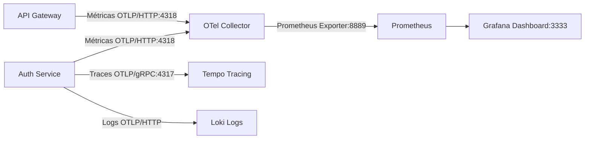

# 💳 Financial System — Monorepo

Este é o repositório principal do **Financial System**, uma arquitetura distribuída e moderna estruturada como um **Monorepo** utilizando `pnpm` workspaces. O projeto conta com microsserviços de backend em **NestJS**, um frontend em **React SPA** estruturado com arquitetura limpa, e uma stack completa de **Observabilidade e Telemetria** integrada nativamente com OpenTelemetry.

---

## 📂 Estrutura de Pastas (Monorepo)

O projeto está organizado da seguinte forma:

```text
financial-system/
├── apps/                         # Aplicações executáveis
│   ├── backend/                  # Microsserviços de Backend (NestJS)
│   │   ├── api-gateway/          # Ponto de entrada unificado do backend (Porta 4000)
│   │   └── auth-service/         # Serviço de autenticação e controle de acesso (Porta 3001)
│   └── web/                      # Aplicação Frontend
│       └── front/                # React (Vite, TypeScript, TailwindCSS v4) (Porta 5173)
│           └── src/
│               ├── app/          # Centralizador de bootstrap: providers.tsx, router.tsx, api.ts, i18n.ts
│               ├── components/   # Design System e componentes visuais puros (ex: /ui)
│               ├── features/     # Casos de uso do negócio isolados (ex: transações, contas)
│               ├── hooks/        # Hooks utilitários globais do app
│               └── utils/        # Formatadores e funções matemáticas auxiliares
│
├── packages/                     # Bibliotecas compartilhadas locais (workspace)
│   ├── ts-config/                # Configurações compartilhadas do TypeScript
│   ├── eslint-config/            # Padronização de linter de código
│   ├── shared-errors/            # Padronização de tratamentos de erros entre serviços
│   └── shared-services/          # Serviços compartilhados (Service Environment, Helpers)
│
├── docker/                       # Arquivos de configurações auxiliares dos containers
│   ├── observability/            # Configurações do OTel Collector, Prometheus e Tempo
│   └── rabbitmq/                 # Configurações e definições do broker de mensageria
│
├── env-files/                    # Arquivos de ambiente (.env) mapeados por microsserviço
└── scripts/                      # Scripts utilitários de suporte ao desenvolvimento
```

---

## 🛠️ Stack de Docker e Redes Virtuais

A infraestrutura de desenvolvimento é executada em camadas isoladas usando arquivos especializados do **Docker Compose**:

| Arquivo de Compose | Função principal | Serviços Inclusos |
| :--- | :--- | :--- |
| `docker-compose.deps.yml` | Serviços de banco de dados e mensageria | Postgres (`database`), RabbitMQ (`broker`) |
| `docker-compose.infra.yml` | Stack unificada de monitoramento e telemetria | Prometheus, Loki, Tempo, OpenTelemetry Collector, Grafana |
| `docker-compose.dev.yml` | Microsserviços do Backend em ambiente dev | `api-gateway-dev`, `auth-dev` |

### Redes do Docker (Isolamento de Segurança)
Para garantir o isolamento e comunicação segura dos microsserviços, utilizamos redes externas com escopo de ambiente (`-dev`, `-test`, `-prod`):
1. **`financial-db-net-dev`**: Isola o banco de dados Postgres para acesso exclusivo dos microsserviços.
2. **`financial-mq-net-dev`**: Canal de comunicação assíncrona isolado para o RabbitMQ broker.
3. **`financial-obs-net-dev`**: Rede que engloba a stack de telemetria (onde o OTel Collector recebe dados e é raspado pelo Prometheus).

---

## 📊 Stack de Observabilidade e Telemetria

Os microsserviços de backend estão equipados com o **OpenTelemetry Node SDK** para instrumentação automática de métricas HTTP e de servidor Express.

### Fluxo de Coleta de Métricas


* **OpenTelemetry Collector (`otel-collector`):** Centraliza o recebimento de métricas, traces e logs dos microsserviços e exporta de forma otimizada para suas respectivas ferramentas de armazenamento.
`link: https://opentelemetry.io/docs/languages/js/getting-started/nodejs/#instrumentation`
* **Prometheus:** Raspa as métricas estruturadas expostas pelo OTel Collector no endpoint `opentelemetry-collector:8889`.
* **Tempo & Loki:** Recebem os rastros (tracing distribuído) e logs consolidados, respectivamente.
* **Grafana (Porta 3333):** Interface visual unificada para criação de gráficos, monitoramento de saúde do sistema e debug distribuído.

---

## 🚀 Como Executar o Projeto Localmente

### Pré-requisitos
* **Node.js** (versão `>= 24.0.0`)
* **pnpm** (gerenciador de pacotes)
* **Docker** e **Docker Compose v2** instalado e ativo

### Passo 1: Instalar Dependências do Monorepo
Na raiz do projeto, instale todos os pacotes das aplicações e workspaces:
```bash
pnpm install
```

### Passo 2: Criar as Redes Virtuais do Docker
Gere as redes internas virtuais do Docker antes de iniciar os serviços:
```bash
pnpm run docker:networks
```

### Passo 3: Subir os Bancos de Dados e Mensageria (Dependencies)
Inicie o Postgres e o RabbitMQ em segundo plano:
```bash
pnpm run deps:up
```

### Passo 4: Subir a Stack de Monitoramento (Observability)
Inicie o painel do Grafana, Prometheus e o OTel Collector:
```bash
pnpm run infra:up
```

### Passo 5: Iniciar os Microsserviços do Backend
Construa e inicie os serviços de backend `auth-service` e `api-gateway` via Docker Compose de desenvolvimento:
```bash
docker compose --profile dev -f docker-compose.dev.yml up -d --build
```
> [!NOTE]
> Os logs da aplicação de backend em tempo real podem ser inspecionados via:
> `docker compose -f docker-compose.dev.yml logs -f`

### Passo 6: Iniciar o Frontend em Modo de Desenvolvimento
Entre na pasta do frontend e suba o servidor Vite local:
```bash
cd apps/web/front
pnpm run dev
```
Acesse o aplicativo no navegador em: `http://localhost:5173`

---

## 🛠️ Atalhos de Scripts (Root CLI)

Abaixo estão os scripts globais definidos no `package.json` raiz para gerenciar os ambientes de forma simplificada:

* **`pnpm run docker:networks`**: Executa o script de criação automatizada das redes virtuais de desenvolvimento.
* **`pnpm run deps:up`**: Sobe Postgres e RabbitMQ (`docker-compose.deps.yml`).
* **`pnpm run deps:down`**: Desliga os bancos e remove os containers de dependências.
* **`pnpm run infra:up`**: Inicializa Grafana, Prometheus, Tempo, Loki e OTel Collector (`docker-compose.infra.yml`).
* **`pnpm run infra:down`**: Desliga toda a infraestrutura de monitoramento.
* **`pnpm run lint`**: Roda o linter de verificação estática do código em todo o monorepo.
* **`pnpm run lint:fix`**: Roda o linter e corrige erros sintáticos de formatação automaticamente.
* **`pnpm run test:load:k6`**: Executa o cenário de teste de carga simulado com `k6` (requer `k6` instalado).
* **`pnpm run test:load:autocannon`**: Executa o teste de estresse de requisições concorrentes na rota de login via `autocannon`.

---

## ⚡ Testes de Carga

Disponibilizamos duas ferramentas para testar o desempenho do sistema sob carga pesada, ideal para gerar volumetria e métricas nos painéis do Prometheus/Grafana:

### 1. Usando Autocannon (Executado via Node.js/npx)
Realiza um teste de estresse rápido disparando requisições concorrentes diretamente no endpoint de login:
```bash
pnpm run test:load:autocannon
```

### 2. Usando k6 (Fluxo de usuário realista)
Simula um fluxo completo de ponta a ponta (registro de novos usuários com credenciais dinâmicas para evitar colisões no banco + logins consecutivos) sob concorrência e rampa de subida (requer o [k6](https://k6.io/) instalado na máquina):
```bash
pnpm run test:load:k6
```

